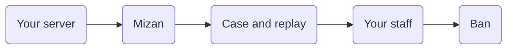

<div align="center">

<a href="https://mizan.ac">
  <picture>
    <source media="(prefers-color-scheme: dark)" srcset=".github/assets/mizan-dark.svg">
    <source media="(prefers-color-scheme: light)" srcset=".github/assets/mizan-light.svg">
    
  </picture>
</a>

### Server-side anti-cheat for Garry's Mod

[](https://mizan.ac/anti-cheat)
[](https://discord.gg/fRbk43tKcV)
[](https://mizan.ac/anti-cheat)
[](https://mizan.ac/dashboard/new)

[Website](https://mizan.ac) · [What it detects](https://mizan.ac/anti-cheat) · [Comparison](https://mizan.ac/anti-cheat/compare) · [Blog](https://mizan.ac/blog) · [Discord](https://discord.gg/fRbk43tKcV)

</div>

<br>

Mizan catches aimbots, silent aim, triggerbots, anti-aim, bunny hop scripts, fake lag and server crashers by how
players aim, move and time their commands on your Garry's Mod server. Players install nothing, and there is nothing on
their computer for a cheat to hide from. Its fog of war stops your server sending a player the positions of enemies they
can't see, so a wallhack or ESP has nothing to draw.

> [!NOTE]
> Mizan is in early access and free, opening to Garry's Mod communities one at a time.
> [Register your community](https://mizan.ac/dashboard/new) to get it.

## How it works



The module on your server reads what the game already receives from each player and sends it on. It makes no
judgements itself, so there is nothing on your server for a cheat to find or switch off.

On the detection service, AI models trained on real play score each fight by how the view moves against its target
before, during and after the shot. Algorithmic detectors test what a hand on a mouse can and can't do, and whether the
numbers the game sends add up. A case opens only when two independent kinds of measurement agree, and each detector
alarms only when a reading is at least 10,000 times likelier from a cheat than from real players' recorded play.
Headshot rates and kill counts are never an input: good players have high ones too.

Your staff see every case with its findings and a 3D replay, and decide before anyone is banned. Mizan also reads
hundreds of public ban lists, so a player banned on other communities is known the moment they join.

## What it detects

37 cheat features in six groups, each described by what the cheat does in a game. How each one is found
isn't published.

<details>
<summary><b>Aim, sight and shooting</b> · 10</summary>

| Cheat | What it does |
| :--- | :--- |
| Aimbot | Turns the player's aim onto an enemy's hitbox, by setting the angles outright or by faking mouse input. |
| Silent aim | Aims each shot at an enemy while the player's own screen and crosshair stay where they were. |
| pSilent | Perfect silent aim: changes the aim only in the command that fires and holds it back, so not even a spectator sees it snap. |
| Triggerbot | Fires the moment an enemy's hitbox is under the crosshair. |
| Rapid fire | Sends a burst of extra commands that tap attack, so a semi-automatic weapon fires like an automatic. |
| Double tap | Saves up ticks, then spends them in one burst to fire a second shot before the weapon is ready (tickbase shifting). |
| No recoil | Takes the weapon's recoil off the aim of every shot, so a spray stays on target. |
| No spread | Works out each bullet's random spread and aims against it, so every shot lands where the crosshair points. |
| Backtrack | Rewrites the shot's tick so the server's lag compensation checks where the enemy stood a moment ago. |
| Engine prediction | Runs the game's movement prediction first, so the aimbot shoots from where the player will be this tick. |

</details>
<details>
<summary><b>Movement and view</b> · 7</summary>

| Cheat | What it does |
| :--- | :--- |
| Anti-aim | Sends fake and real pitch and yaw, fixed, jittering or spinning (a spinbot), so enemies aim at the wrong place. |
| Desync | A desynculator: knocks the player's commands out of step with the server's clock, so where they stand and where they can be hit stop matching. |
| Movement fix | Turns the movement keys with the angles the cheat sends, so silent aim and anti-aim never change where the player walks. |
| Fake duck | Flicks crouch on and off every other command, so the player looks crouched while shooting from standing height. |
| Air stuck | Stops sending movement, so the player hangs frozen in place, even in mid-air. |
| Bhop | A bunny hop script: presses jump the instant the player lands, so they never lose speed. |
| Auto strafe | Steers left and right in the air for the player to build speed on every jump, in legit, directional and rage modes. |

</details>
<details>
<summary><b>Time and lag</b> · 6</summary>

| Cheat | What it does |
| :--- | :--- |
| Fake lag | Holds back up to a dozen or so commands and sends them at once, so other players see the cheater jump between spots. |
| Fake latency | Answers the server with old packet acknowledgements, so the player's ping looks higher and lag compensation lets them hit further back in time. |
| Reduce latency | Shaves the delay the game builds into the player's connection, so they see and shoot first. |
| Slow motion | Sends fewer commands than the game runs, so the server moves the cheater in slow motion. |
| Warp | Charges up held-back ticks, then releases them at once to cover a long distance in an instant. |
| Sequence freezing | Holds the connection's packet count still while the player keeps moving, then lets it jump forward. |

</details>
<details>
<summary><b>Taunts and spam</b> · 5</summary>

| Cheat | What it does |
| :--- | :--- |
| Loop taunt | Restarts a taunt the moment it ends, so it plays forever. |
| Taunt camera block | Keeps the first-person view during a taunt, so the player can still see and aim. |
| E spammer | Presses Use on every command, spamming doors, buttons and anything else it reaches. |
| Flashlight spammer | Switches the flashlight on and off on every command, flashing it and spamming its click. |
| Noise maker | Makes noise for everyone nearby, over and over. |

</details>
<details>
<summary><b>Hiding the cheat</b> · 6</summary>

| Cheat | What it does |
| :--- | :--- |
| Patched mouse movement | Rewrites the mouse movement in each command to match the aim the cheat set, so it looks like it came from a hand. |
| Patched key input | Rewrites the key presses in each command to match the buttons the cheat pressed, so they look typed. |
| Caught Lua errors | Catches errors from the cheat's Lua scripts so they never show in the console or reach the server. |
| Blocked console commands | Refuses the commands the server runs on the player's game, such as connect, disconnect and say_team. |
| Blocked gestures | Stops the gestures the server plays on the player's model. |
| Restored ConVars | Puts the game settings the cheat changed back as they were, so they read as untouched. |

</details>
<details>
<summary><b>The server itself</b> · 3</summary>

| Cheat | What it does |
| :--- | :--- |
| Game events | Fakes game events the player never caused. |
| Server laggers | Server crashers: flood the server with oversized voice data, file requests or string commands until it lags or crashes. |
| Network exploits | Sends fake net messages to addons for free money, items or admin. |

</details>

## Fog of war

A wallhack or ESP can only draw what your server sends it. Mizan's vision system stops your server sending a player the positions of enemies they have no way to see.

Source already sends each player only what the map's potentially visible set (PVS) allows, and that set often takes in
everyone behind the next wall. Mizan feeds what its module measures into the engine's own visibility, so an enemy is
sent only once you could see them, and a moment before they round a corner so nobody pops in late. VALORANT and Rust
hold back hidden enemies the same way. Anyone you could already see or hear is still sent.

## Install

1. On your community's dashboard at [mizan.ac](https://mizan.ac), open **Downloads**, choose the server and its
   platform, and download the module.
2. Extract it into the folder that holds `garrysmod/`. This adds the module, its settings and the server's key, and
   loads Mizan whenever the server starts.
3. Load it from the server console, with no restart, using the command the dashboard shows:

   ```
   plugin_load lua/bin/<loader for your platform>
   ```

4. Run `mizan_status` in the console. The server shows as **Connected** on its dashboard page within seconds.

Servers already running the module update themselves.

### Requirements

| | |
| :--- | :--- |
| Server | Garry's Mod dedicated server that can load binary modules |
| Platforms | Linux and Windows, 32-bit and 64-bit (the x86-64 branch is 64-bit; a default install is 32-bit) |
| Admin mods | SAM, ULX, sAdmin, ServerGuard, xAdmin, xAdmin 2, Lyn, D3A, FAdmin, or a ban command of your own |

## Support

| | |
| :--- | :--- |
| Setting up and questions | [Discord](https://discord.gg/fRbk43tKcV) or contact@mizan.ac |
| Disputing a ban | [mizan.ac/disputes](https://mizan.ac/disputes) |
| Security | [mizan.ac/security](https://mizan.ac/security), by email, never in an issue |

Please don't post SteamIDs or player details in a public issue.

<br>

<div align="center">
<sub><a href="https://mizan.ac">mizan.ac</a> · KORDU LTD</sub>
</div>
